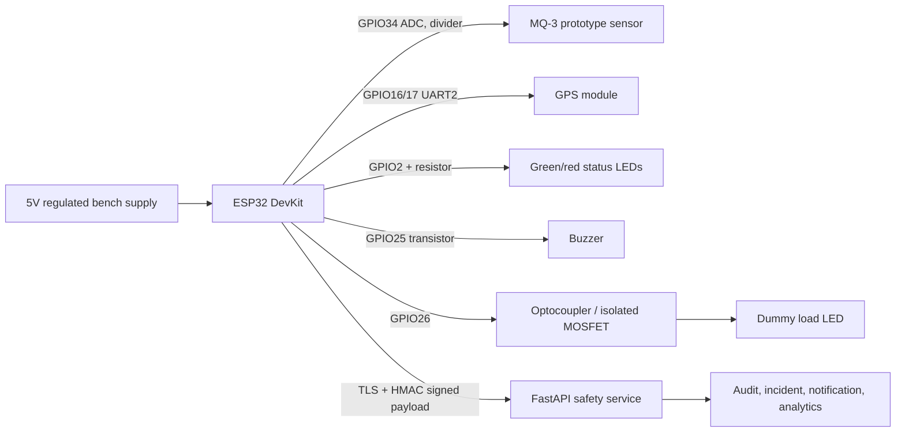

# Hardware application and circuit diagram

`hardware/esp32/device_adapter.h` defines the replaceable adapter boundary.
`simulator/` exercises signed readings without pretending to be a certified
breathalyzer.

The implemented hardware application is the ESP32 bench-safe reference firmware
in `hardware/esp32/src/main.cpp`. It reads a prototype analog sensor, exposes
safe/blocked indicators, emits a heartbeat boundary, and drives only an
isolated dummy-load output. It intentionally cannot start or disable a real
vehicle.

## Circuit diagram

The cloud service returns a decision, but the prototype output is restricted to
the dummy load. Do not substitute a vehicle starter or ignition connection.

A production device needs secure provisioning, unique credentials, secure boot,
signed OTA firmware, watchdog recovery, calibration records, tamper evidence,
GPS and heartbeat reporting, offline behavior, and a separately validated
vehicle gateway. Never connect prototype MQ-3 output or browser code directly
to a starter relay.
