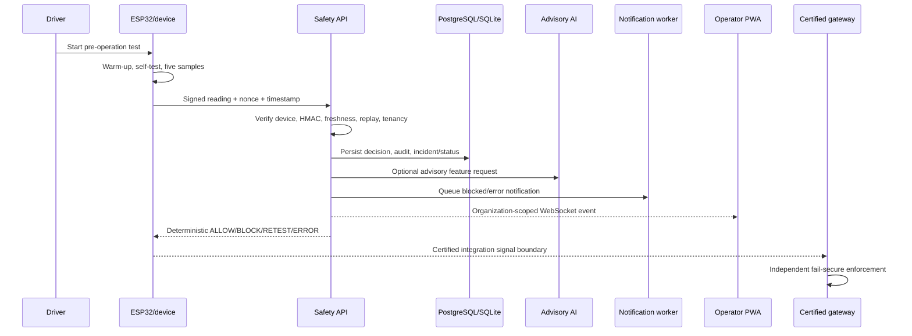

# AI Smart Alcohol Detection Product

This repository contains a complete **software product and bench-hardware
reference product** for an alcohol-detection vehicle interlock workflow.
The system is fail-secure: only a fresh, authenticated, valid negative test can
produce an allow decision. Missing, stale, replayed, tampered, inconsistent,
positive, or unavailable readings remain blocked or error states.

## Product modules

| Module | Location | Product responsibility |
|---|---|---|
| Operator PWA | `public/`, `server.js` | Browser fleet/interlock workflows and legacy API |
| Safety API | `services/api/` | Auth, RBAC, tenancy, devices, decisions, incidents, GPS, reports |
| AI engine | `services/ai-engine/` | Advisory features and anomaly metadata; never controls safety |
| Notification service | `services/notification-service/` | Durable outbox and retrying provider worker |
| Device simulator | `simulator/` | Signed end-to-end device contract testing |
| ESP32 firmware | `hardware/esp32/` | Bench sensor state machine and isolated output reference |
| Database migrations | `services/api/alembic/` | Reviewed production schema lifecycle |
| Deployment | `docker-compose.yml`, `Dockerfile` | Local multi-service runtime foundation |

## Start the complete local product

### Node/PWA

```sh
npm ci
npm start
```

Open `http://localhost:3000`.

### FastAPI safety platform

```sh
cd services/api
py -3 -m pip install -r requirements.txt
py -3 -m uvicorn app.main:app --reload --port 8000
```

For production-like startup, configure `DATABASE_URL`, `JWT_SECRET`,
`DEVICE_ENCRYPTION_KEY`, `CORS_ORIGINS`, and `AUTO_CREATE_SCHEMA=false`, then
run:

```sh
alembic upgrade head
py -3 -m uvicorn app.main:app --host 0.0.0.0 --port 8000
```

### All containerized services

```sh
docker compose up --build
```

This starts PostgreSQL, Redis, the safety API, advisory AI service, and
notification API. Run the notification worker separately in its service
environment:

```sh
cd services/notification-service
py -3 -m app.worker
```

Email, SMS, and push delivery require an approved provider adapter and explicit
provider configuration. The worker never reports delivery success when a
provider is not configured.

## End-to-end acceptance flow

1. Register the first local account; it becomes the bootstrap administrator.
2. Create an organization, vehicle, and device through the API.
3. Keep the generated device secret in a secret manager.
4. Generate a signed simulator reading:

   ```sh
   py -3 simulator/device_simulator.py `
     --device-id DEVICE_ID `
     --vehicle-id VEHICLE_ID `
     --secret PROVISIONED_SECRET `
     --reading 0.01
   ```

5. Submit the signed payload to `/decisions`.
6. Verify that a valid negative reading produces `UNLOCKED`.
7. Submit a positive reading and verify `LOCKED`, incident, notification, and
   vehicle status update.
8. Replay the same nonce and verify another `LOCKED` decision.
9. Send a stale, malformed, or invalid-signature payload and verify it remains
   fail-secure.
10. Subscribe to `/ws/organizations/{organization_id}` and verify live
    decision events are delivered only to users in that organization.

## Hardware product workflow

Follow `docs/HARDWARE_CONFIGURATION.md` for the bill of materials, wiring,
device identity configuration, PlatformIO build, flashing, serial checks, and
bench acceptance tests. The firmware provides:

- Sensor warm-up and self-test
- Five-sample consistency validation
- `BOOTING`, `SELF_TEST`, `READY`, `TESTING`, `ANALYZING`, `SAFE`, `BLOCKED`,
  and `ERROR` states
- Watchdog recovery
- JSON heartbeat and sensor events
- A momentary local test button
- Fail-closed isolated dummy-load output

## Security and operations

Implemented controls include encrypted device secrets, HMAC device
attestation, nonce replay protection, timestamp freshness, PBKDF2 password
hashing, short-lived JWT access tokens, rotating refresh tokens, TOTP MFA,
role-based authorization, organization isolation, audit records, request
hardening, durable notification retries, and migration-controlled schemas.

Review `docs/SECURITY.md`, `docs/OPERATIONS.md`, `docs/DEPLOYMENT.md`, and
`docs/PRIVACY.md` before deployment.

## Product completion boundary

The application and bench product are implemented and buildable. A real
vehicle/government deployment additionally requires work that cannot be
completed safely by source code alone:

- Certified breathalyzer hardware and traceable calibration
- Automotive-rated power, isolation, enclosure, and connectors
- Certified ECU/gateway integration and a reviewed recovery policy
- Secure boot/eFuse provisioning, signed OTA, and tamper evidence
- Hardware-in-the-loop, environmental, EMC, and electrical safety testing
- Regulatory, legal, privacy, accessibility, and procurement approval
- Independent penetration testing and functional-safety certification

Until those gates pass, GPIO26 must remain connected only to the isolated
bench dummy load and the prototype sensor must not be treated as a legal BAC
instrument.

## Product definition

### Problem

The product provides a controlled safety workflow for testing a driver before
vehicle operation. A device captures a breath/sensor reading, authenticates the
reading, sends it to the safety service, and receives a deterministic decision.
The decision is recorded for operators and can be consumed by a separately
certified vehicle gateway.

### Product goals

- Prevent an authenticated positive or uncertain test from becoming an allow
  decision.
- Give fleet operators current vehicle, device, incident, and decision status.
- Preserve an auditable record of every safety decision and administrative
  action.
- Support controlled device provisioning, revocation, replay protection, and
  offline/error handling.
- Keep advisory AI separate from the deterministic safety policy.
- Provide a reproducible bench device and simulator for integration testing.

### Non-goals

- The prototype MQ-3 sensor is not a legal breathalyzer.
- The browser, Node service, or ESP32 reference output must not directly switch
  a starter, ignition, CAN bus, fuel pump, or vehicle relay.
- AI anomaly scoring cannot override a deterministic block or grant permission
  to start.
- The repository does not claim regulatory, automotive functional-safety, or
  government procurement certification.

## Users and roles

| Role | Capabilities |
|---|---|
| Administrator | Bootstrap system, organizations, operators, devices, reports, audit |
| Operator | Manage assigned organization fleet, devices, incidents, notifications |
| Driver | Authenticate, complete assigned tests, view permitted vehicle state |
| Technical team | Provision and revoke devices in the legacy PWA workflow |
| Safety reviewer | Review incidents, calibration evidence, audit records, and reports |

Every organization-owned resource is scoped by organization. Administrators may
operate across organizations; operators and drivers cannot select another
organization through request payloads.

## Safety decision model

The safety service uses a fail-secure decision contract:

| Input condition | Decision | Vehicle result |
|---|---|---|
| Fresh, signed, paired, non-replayed reading below configured threshold | `ALLOW`/`UNLOCKED` | May proceed to certified gateway |
| Reading at/above threshold | `BLOCK`/`LOCKED` | Must remain stopped |
| Inconsistent multi-sample test | `RETEST` | Must remain stopped until retest |
| Missing device, unavailable sensor, invalid signature, stale timestamp, replay, malformed data, or internal error | `ERROR`/`LOCKED` | Must remain stopped |

The API persists the decision, updates vehicle status, creates incidents for
blocked/error paths, emits organization-scoped live events, and queues operator
notifications. The vehicle gateway must independently fail closed if the API,
device, power, network, or gateway watchdog is unavailable.

## End-to-end data flow



The AI request is informational only. It is never in the critical path that
changes an allow/block decision.

## Software component detail

### Node/PWA

The legacy Node/Express application provides the installable browser workflow:
registration, session authentication, vehicle management, technical-team device
pairing, simulator submission, fleet status, decision history, audit views, and
service-worker/PWA assets. It remains available for the original demonstrator
and uses the versioned `/api/v1/interlock` contract.

### FastAPI safety API

Important routes include:

| Area | Routes |
|---|---|
| Authentication | `/auth/register`, `/auth/login`, `/auth/refresh`, `/auth/logout`, `/auth/password`, `/auth/me` |
| MFA | `/auth/mfa/enroll`, `/auth/mfa/verify`, `/auth/mfa/disable` |
| Fleet | `/organizations`, `/vehicles`, `/drivers`, `/assignments` |
| Devices | `/devices`, `/devices/{id}/heartbeat`, `/devices/{id}/status`, `/devices/{id}/revoke` |
| Safety | `/decisions`, `/sensor-tests`, `/vehicles/{id}/status`, `/vehicles/{id}/decisions` |
| Operations | `/incidents`, `/notifications`, `/gps`, `/analytics/overview`, `/reports/decisions.csv`, `/audit` |
| Live updates | `/ws/organizations/{organization_id}` |
| Service health | `/health`, `/readiness` |

Database entities include users, organizations, vehicles, drivers, driver
assignments, devices, decisions, sensor tests, incidents, notifications,
GPS points, audit logs, nonces, refresh tokens, and MFA state. Production
schema changes are applied with Alembic.

### AI engine

The AI engine extracts bounded sensor features and produces anomaly metadata.
It is advisory and must be deployed, monitored, evaluated, and versioned
separately from the safety policy. A model failure must not convert a blocked
or uncertain test into an allow.

### Notification service

The API queues notifications through the durable outbox boundary. The separate
worker claims pending messages, invokes an explicitly configured provider,
records provider IDs and delivery timestamps, and retries failures up to
`NOTIFICATION_MAX_ATTEMPTS`. In-app delivery has a local adapter. Email, SMS,
and push require deployment-specific provider implementations and credentials.

## Data and security model

### Device trust

Each device is paired to one vehicle and receives a unique secret. The service
encrypts the stored secret with Fernet. Signed readings include device ID,
vehicle ID, nonce, timestamp, and reading in a canonical string. The service
checks:

1. Device exists, is enabled, and is not revoked.
2. Device is paired to the submitted vehicle.
3. HMAC signature matches the encrypted device secret.
4. Nonce has not already been recorded.
5. Timestamp is inside the configured freshness window.
6. Reading and payload pass schema/range validation.

### Account trust

Passwords use PBKDF2-HMAC-SHA256 with per-password salts. Access tokens are
short-lived JWTs; refresh tokens are hashed, rotated, and revoked on logout or
password change. TOTP MFA secrets are encrypted at rest and MFA is required
at login after enrollment. Role and organization checks are enforced on the
server, not only in the UI.

### Operational security

Production must use non-default secrets, HTTPS/TLS, a managed secret store,
restricted CORS, PostgreSQL, Redis where needed, backups, log retention,
central monitoring, alerting, dependency scanning, key rotation, and
least-privilege deployment identities. Never commit device secrets, JWT keys,
passwords, certificates, or provider credentials.

## Hardware product detail

### Reference bill of materials

- ESP32 DevKit with production secure boot/flash encryption capability
- Calibrated sensor selected by the safety/electrical team; MQ-3 is bench-only
- 5 V regulated supply and 3.3 V-safe ADC divider
- 220 ohm LED resistor and status LED
- Transistor-driven active buzzer
- Momentary test button
- Optocoupler or isolated MOSFET and LED/resistor dummy load
- Enclosure, tamper switch, watchdog-capable power path, protected connectors
- Optional GPS module on level-shifted UART2

### Pin map

| Pin | Signal | Rule |
|---:|---|---|
| GPIO34 | Sensor ADC | Never exceed 3.3 V; calibrated driver required |
| GPIO2 | Status LED | Current-limited LED only |
| GPIO25 | Buzzer | Transistor driver; no high-current load |
| GPIO26 | Bench output | Isolated LED/dummy load only |
| GPIO27 | Test button | Momentary switch to ground |
| GPIO16/17 | GPS UART2 | Level-shift modules above 3.3 V |

### Firmware states

`BOOTING` initializes outputs low; `SELF_TEST` validates the sensor;
`READY` waits for warm-up or a button; `TESTING` captures five samples;
`ANALYZING` evaluates consistency; `SAFE` asserts only the isolated bench
output temporarily; `BLOCKED` deasserts output and alerts; `ERROR` deasserts
output for missing/noisy faults; `OFFLINE` is reserved for a future transport
implementation. Watchdog reset is treated as fail-secure.

## Deployment topology

### Local/demo

Node/PWA runs on port 3000. FastAPI runs on port 8000. AI engine runs on port
8001 and notification API on port 8002. Docker Compose supplies PostgreSQL and
Redis for the multi-service path.

### Production target

Use a managed container platform behind HTTPS with private database/network
endpoints, managed PostgreSQL, Redis, secret storage, centralized logs and
metrics, health/readiness probes, autoscaling, backup/restore, and a separate
notification worker. Run Alembic migrations as a deployment step before
starting API replicas. The API should not auto-create production schemas.

## Validation and acceptance

Run the repository checks:

```sh
npm test
npm run lint
py -3 -m pytest services/api/tests -q
py -3 -m pytest services/ai-engine/tests -q
py -3 -m pytest services/notification-service/tests -q
pio run -d hardware/esp32
```

Acceptance requires all checks to pass and manual confirmation of:

- valid negative reading allows only through the approved gateway boundary;
- positive, stale, replayed, malformed, missing, and noisy cases remain blocked;
- cross-organization API and WebSocket access is denied;
- revoked devices cannot produce allow decisions;
- notification failures retry without changing safety outcomes;
- ESP32 reset, sensor failure, power loss, and watchdog paths leave output low;
- no real vehicle wiring is present during bench tests.

## Support and incident response

For a blocked vehicle, preserve the decision ID, device ID, nonce, timestamp,
sensor evidence, firmware version, operator, and organization. Do not manually
override a blocked decision through the browser. Escalate to the authorized
safety/operator process, inspect device status and audit logs, and use the
approved manual recovery policy only after safety review.

For a suspected compromised device, revoke it immediately, preserve logs,
rotate its secret, inspect replay/signature failures, and replace/re-provision
the hardware. For a suspected account compromise, revoke refresh tokens,
disable MFA enrollment if necessary, rotate affected credentials, and review
audit events.

## Final delivery statement

The repository delivers the application source, APIs, service boundaries,
security controls, database migrations, simulator, notification worker,
ESP32 firmware, hardware configuration, documentation, CI, and tests needed
for a demonstrator and integration program. It is not a substitute for the
certified automotive controller, legal breathalyzer, regulatory evidence,
physical installation, or independent safety and cybersecurity approval
required for a government production product.
